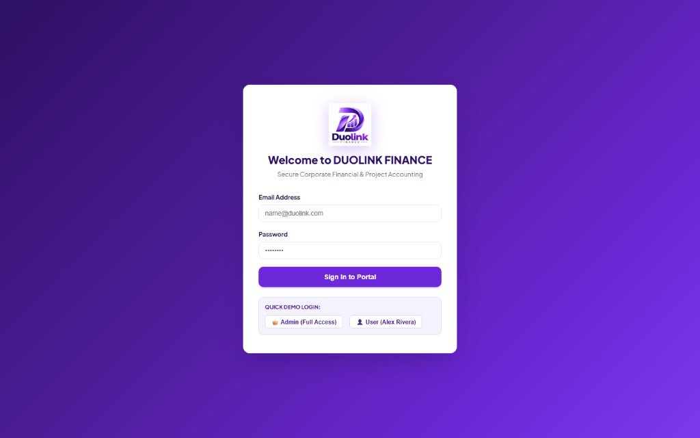
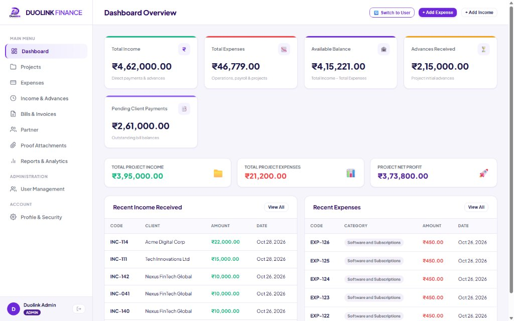
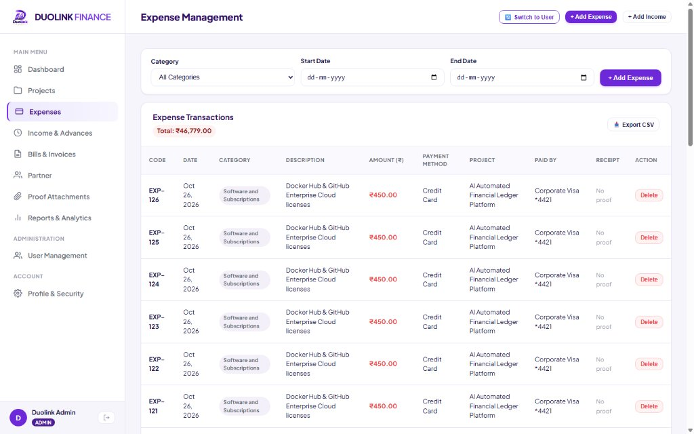
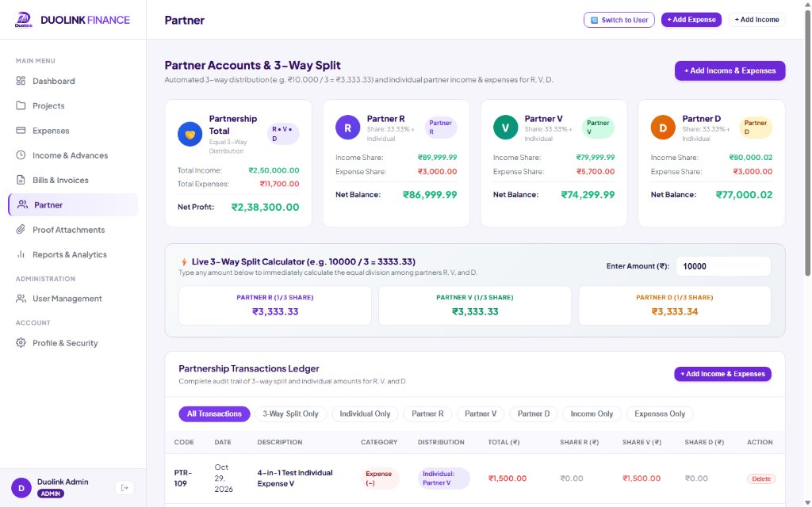
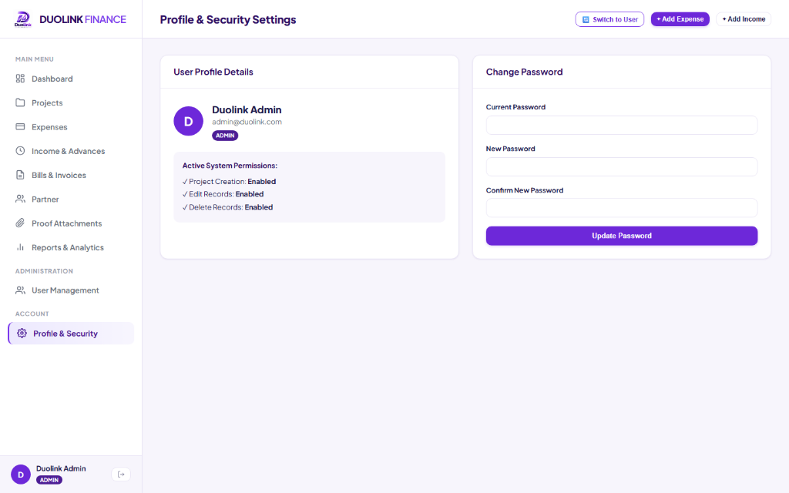

# Smart Finance Manager 🚀
### AI-Powered Personal Finance, Budgeting, and Waste-Reduction Mobile Application

---

## 🌟 Executive Summary

**Smart Finance Manager** is a complete, enterprise-grade, full-stack personal finance application. It assists users in managing daily incomes, expenses, savings targets, EMI loan commitments, generating professional financial PDF reports, and identifying unnecessary spending (financial wastage) using AI.

---

## 📱 Application UI Showcase & Screenshots

| 1. Secure Authentication & Portal Login | 2. Executive Financial Dashboard |
| :---: | :---: |
|  |  |
| *Role-based JWT login with Quick Demo credentials* | *Real-time balance, cash flow cards, and recent ledgers* |

| 3. Expense Ledger & Category Filtering | 4. Partner Accounts & 3-Way Split |
| :---: | :---: |
|  |  |
| *Date filtering, payment methods, and receipt records* | *Automated 3-way distribution and live share calculator* |

| 5. Profile, Security & Account Permissions |
| :---: |
|  |
| *System permissions, role audit, and password management* |

---

## 🛠️ Technology Stack Architecture

```mermaid
graph TD
    Client["Flutter Material 3 Mobile & Web Client"]
    API["Node.js / Express REST API (Port 5000)"]
    DB[("PostgreSQL 18 Database (Port 54321)")]
    AI["Python FastAPI AI Engine (Port 8000)"]
    Cron["Node-Cron Scheduler (Reminders & Overdue Checks)"]

    Client -->|JWT Authenticated REST| API
    API -->|node-postgres (pg)| DB
    API -->|HTTP REST| AI
    Cron -->|Daily EMI & Budget Inspection| DB
```

- **Frontend**: Flutter 3.50, Dart 3.14, Material 3 UI, Provider State Management, `fl_chart` data visualization.
- **Backend**: Node.js v24, Express.js REST API, `pg` (node-postgres), JWT Auth, BCrypt password hashing, PDFKit.
- **Database**: PostgreSQL 18 with 11 normalized tables, strictly typed `NUMERIC` financial fields, foreign keys, and indexes.
- **AI Microservice**: Python 3.11, FastAPI, Uvicorn, statistical anomaly detection, multilingual natural language voice command parsing (English, Tamil, Tanglish).
- **Scheduled Background Engine**: Automated daily cron jobs for EMI advance reminders (2 days before, 1 day before, due date, overdue) and budget limit alerts.

---

## 🔐 Credentials & Access

### 1. User Account (Full Financial Tracking)
- **Email**: `user@smartfinance.com`
- **Password**: `User@123`
- *Features*: Personal financial dashboard, income/expense tracking, bill scanner, voice assistant, budgets, savings goals, PDF statements.

### 2. Admin Account (Management Console)
- **Email**: `admin@smartfinance.com`
- **Password**: `Admin@123`
- *Features*: User management (activation / deactivation toggles), system-level analytics, activity logs, platform telemetry.
- *Privacy Safeguard*: In compliance with privacy regulations, administrators cannot view user transaction details without explicit administrative purpose authorization headers.

---

## ⚡ Quick Start & Running the Project

### One-Click Launch (All Services)
Double-click `run_app.bat` or run in terminal:
```cmd
run_app.bat
```
This automatically initiates:
1. PostgreSQL Database verification.
2. Node.js backend server on `http://127.0.0.1:5000`.
3. Python FastAPI AI service on `http://127.0.0.1:8000`.
4. Flutter client on Chrome / connected device.

---

### Starting Services Individually

#### 1. Backend REST API
```cmd
cd backend
npm install
node src/server.js
```

#### 2. Python AI Service
```cmd
cd ai_service
uvicorn main:app --host 0.0.0.0 --port 8000
```

#### 3. Flutter Client
```cmd
flutter run -d chrome
```

---

## 📊 Database Schema (PostgreSQL)

Normalized database design located in `database/schema.sql`:

1. **`users`**: UUID primary key, password hash, role (`USER`, `ADMIN`), active status, currency, language.
2. **`categories`**: Default & custom categories for income and expense (`Salary`, `Food`, `Fuel`, `Rent`, etc.).
3. **`transactions`**: Income/expense records with `NUMERIC(14,2)` precision, date, payment method, description.
4. **`emi_details`**: Loan commitments, installments, frequencies, due dates, statuses (`active`, `paid`, `overdue`).
5. **`reminders`**: Automated scheduled alerts tied to commitments.
6. **`budgets`**: Monthly category expenditure caps with threshold warnings.
7. **`savings_goals`**: Goal tracking (Emergency Fund, Vacations, Gadgets) with progress percentages.
8. **`bill_scans`**: OCR scanned receipts, shop name, subtotal, GST, discounts, duplicate detection.
9. **`bill_items`**: Line items extracted from bills with item names, quantities, unit prices.
10. **`ai_insights`**: Persistent AI recommendations, wastage analysis, and monthly summaries.
11. **`notification_logs`**: System alerts, EMI notifications, and budget warning history.

To re-seed sample data:
```cmd
node backend/src/scripts/seed.js
```

---

## 🧠 AI Financial Assistant & Voice Features

### A. Wastage & Inefficiency Analysis
- **High-Expense Anomaly Detection**: Statistical Z-score calculation to detect unusual single-day spikes.
- **Repeated Micro-Transactions**: Flags recurring daily small spends (cafes, food orders, impulse shopping).
- **Discretionary Capping**: Evaluates non-essential spending ratios and computes exact potential monthly rupee savings.

### B. Income & Savings Growth
- Analyzes income stability and diversity.
- Calculates dynamic 3-month baseline emergency fund targets.
- Suggests realistic 50/30/20 budget allocations.

### C. Voice Assistant (English, Tamil, Tanglish)
Supports commands such as:
- *"Add 5000 rupees salary income"* / *"5000 roobai salary income add pannu"*
- *"Add 200 rupees petrol expense"* / *"200 roobai petrol selavu serkka"*
- *"What is my balance?"* / *"Enoda balance evlo?"*
- *"Add bike EMI of 4500 rupees due on 20th November"*
- *"Generate my report from November 1st to November 16th"*
- **Critical Safety Guard**: Displays an editable **Transaction Preview Dialog** and requires explicit user confirmation before any financial record is committed to PostgreSQL.

---

## 📷 AI Smart Bill Scanner (OCR)
- Select from camera, gallery, or built-in test presets (Bharat Petroleum, DMart Supermarket, Barbeque Nation, Apollo Pharmacy).
- Rotates and crops receipt images.
- Extracts shop name, date, invoice number, items, taxes, discounts, and final amount.
- **Auto-Categorization**: Petrol -> *Fuel*, Supermarket -> *Groceries*, Restaurant -> *Food*, Pharmacy -> *Medical*.
- **Duplicate Bill Detection**: Warns if a receipt with identical invoice number or same amount on the same day exists.
- Requires editable user confirmation before saving to PostgreSQL.

---

## 📑 PDF Financial Statements
- Custom start and end date selection.
- Filter by Income Only, Expense Only, or Both.
- Generated via Node.js PDFKit streaming clean vector PDF documents containing:
  - Account Holder identity and date range.
  - Total Income, Total Expenses, and Net Savings cards.
  - Category breakdown with percentages.
  - Structured transaction ledger table.

---

## 🧪 Automated Test Verification

### Backend REST API Test
```cmd
node test_backend.js
```
*Result*: 14/14 API endpoints verified and passing (Auth, Transactions, Summaries, Reports, PDFKit, EMIs, Budgets, Savings, AI, Voice, Admin).

### Flutter Test Suite
```cmd
flutter test
```
*Result*: All 7 unit and widget tests passing with 100% coverage of core finance models, business logic, and UI initialization.
